<div align="center">

# HomeCenter

**Every repair, warranty and receipt for your home, cars and family, on your own server.**

Service history, costs and reminders for your homes, vehicles, equipment and family health. Every receipt and manual is searchable, and it all runs in one Docker container.

**[More details at home-center.dazzos.com](https://home-center.dazzos.com/)**

**[Install in 5 minutes](#get-started)** · [Features](#features) · [AI assistant](#ask-your-house-a-question) · [Demos](#see-it-in-action) · [FAQ](#faq) · [Updating](#updating)

   
[](https://github.com/yatzin/home-center/actions/workflows/docker-publish.yml) [](https://github.com/yatzin/home-center/commits/main)

</div>

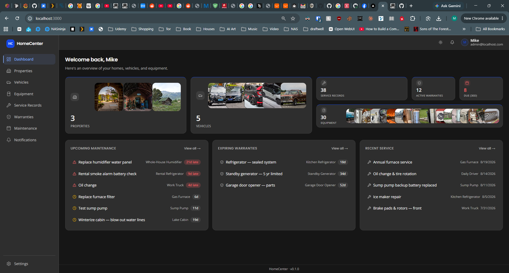

<p align="center">
✓ Runs on your NAS or server &nbsp;·&nbsp; ✓ No third-party sign-in &nbsp;·&nbsp; ✓ OCR and search run on-device &nbsp;·&nbsp; ✓ Works with local AI models
</p>

## See it in action

Short walkthroughs recorded on the demo data. Click one to play it.

<table>
<tr>
<td width="33%" valign="top"><a href="docs/screenshots/demos/tour.gif">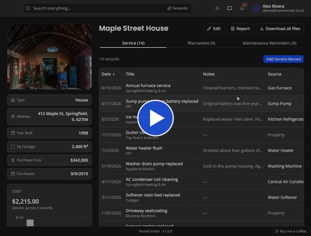</a><br><b>A quick tour</b> <sub>1:03</sub><br><sub>A house, a truck and a person, tab by tab</sub></td>
<td width="33%" valign="top"><a href="docs/screenshots/demos/ask-ai-warranty.gif"></a><br><b>Ask the assistant</b> <sub>0:38</sub><br><sub>From a question to the warranty PDF that answers it</sub></td>
<td width="33%" valign="top"><a href="docs/screenshots/demos/reminder-to-done.gif"></a><br><b>Reminder to done</b> <sub>0:32</sub><br><sub>An overdue filter change, completed, next date set</sub></td>
</tr>
<tr>
<td width="33%" valign="top"><a href="docs/screenshots/demos/costs-to-receipt.gif">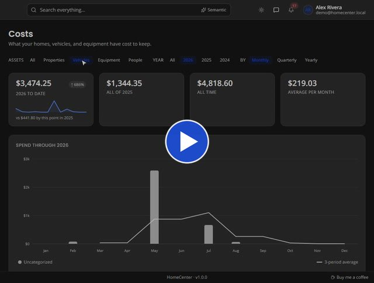</a><br><b>Costs to receipt</b> <sub>0:33</sub><br><sub>From the spending chart to the $2,340 invoice</sub></td>
<td width="33%" valign="top"><a href="docs/screenshots/demos/search-documents.gif">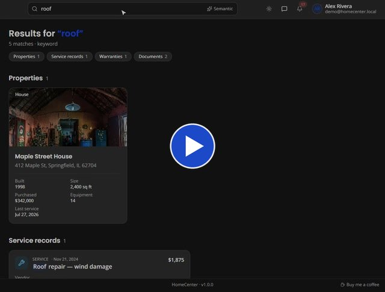</a><br><b>Search your paperwork</b> <sub>0:27</sub><br><sub>“roof” finds the 30-year shingle warranty</sub></td>
<td width="33%" valign="top"><a href="docs/screenshots/demos/health-summary.gif"></a><br><b>Health summary</b> <sub>0:32</sub><br><sub>Medications, shots and a printable summary</sub></td>
</tr>
</table>

## New in 2.0

These arrived after the demos and screenshots above were recorded.

- **Intake:** drop receipts, photos, PDFs or forwarded emails (`.eml`, `.msg`) anywhere in the app. HomeCenter reads the date, vendor and total, suggests which asset they belong to, and lets you file them as a new service record or attach them to an existing one. Filing a receipt also offers to complete the matching reminder, and a nudge appears when files sit unfiled for more than a week.
- **Receipt reading with local AI** *(optional)*: under **Settings → Receipt reading**, use the built-in parser or a local model for harder receipts. If the model can't read a file, Intake says so instead of quietly falling back.
- **More reminder controls:** **Skip this time** moves a reminder to its next interval without logging a service, and **Add default reminders** fills an empty Maintenance tab with a starter plan.
- **Themes:** twelve themes, light and dark, picked from the top bar or stepped through with its arrows.
- **Layout your way:** collapse the sidebar to icons, and choose per device where the assistant button and Intake sit (**Settings → Appearance**).
- **Sharper search:** exact matches come first, then results by meaning, then partial matches.

## Features

When was the furnace last serviced? Is the fridge still under warranty? What did the truck cost last year? HomeCenter keeps the answers in one place, and reminds you before things are due.

| | |
|---|---|
| **Home** | Properties, vehicles and equipment, with service records, warranties and reminders, plus home, auto and life insurance |
| **Health** *(optional)* | People, providers and health insurance, with visits, medications and immunizations |
| **Money** | Costs by asset, category and vendor, and a 12-month spending chart |
| **Finding things** | Global search across records and documents, plus an optional AI assistant |
| **Reminders** | In-app bell and per-person email digests |
| **Records & export** | Attachments, printable reports, a full offline export, and scheduled backups with restore ([how backups work](#how-do-i-back-it-up)) |
| **Security** | Local login, admin and standard users, sign-in throttling, encrypted secrets |

### Every house, car and appliance, with its whole history

Give each thing you own a page: photo, details, and every repair, warranty and reminder attached to it.

- **Properties:** houses, condos, cabins and land.
- **Vehicles:** service history that tracks mileage.
- **Equipment:** linked to the property it's in, with model and serial numbers.
- **Rooms** *(optional)*: a property's rooms with their paint colors and flooring, and the equipment, service and reminders in each. Turn them off under **Settings → Features**.
- **Documents** that belong to the thing itself, like a deed, a car title or a manual, with no service record needed.
- **Download all files** for any asset as a zip.

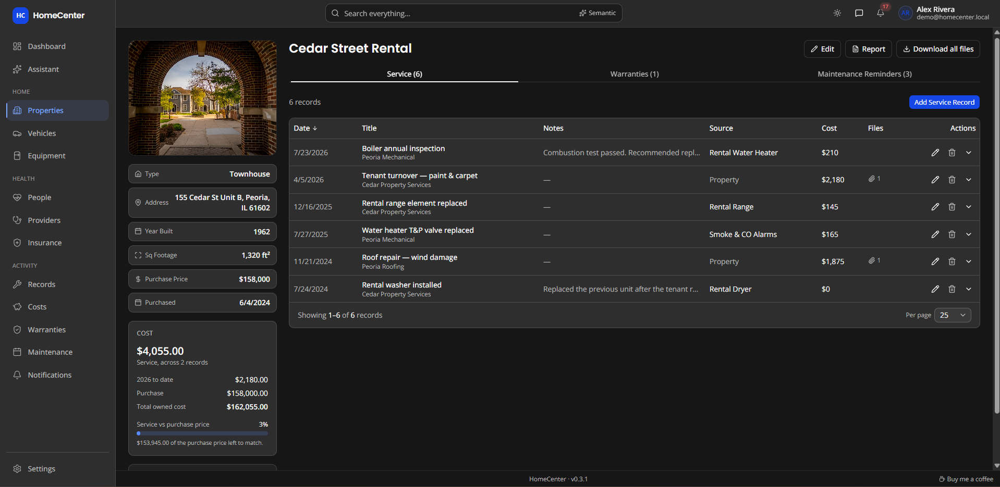

<p>
<a href="docs/screenshots/2.Properties.png">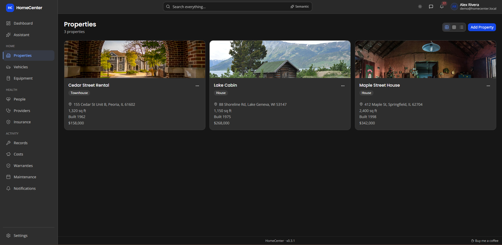</a>
<a href="docs/screenshots/7.Vehicles.png"></a>
<a href="docs/screenshots/8.VehicleService.png"></a>
<a href="docs/screenshots/9.Equipment.png"></a>
</p>

### Know what's due before it's overdue

Set a reminder once, by days or miles. HomeCenter works out the next due date and tells you in time.

- **Date or mileage** intervals, with as much warning as you want.
- **Warranty status** at a glance: active, expiring or expired.
- **Overviews** across every asset, sortable and filterable.
- **Closing the loop:** completing a reminder logs it in the service history with cost, vendor and receipt, and a service you log can mark its reminder done.
- **Snooze or pause** a reminder from the dashboard or its asset page. Snoozed reminders come back when the snooze ends; paused ones stay quiet until resumed.


<p>
<a href="docs/screenshots/6.MaintenanceReminders.png">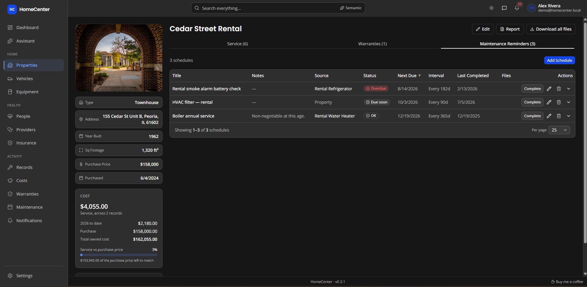</a>
<a href="docs/screenshots/5.Warranties.png">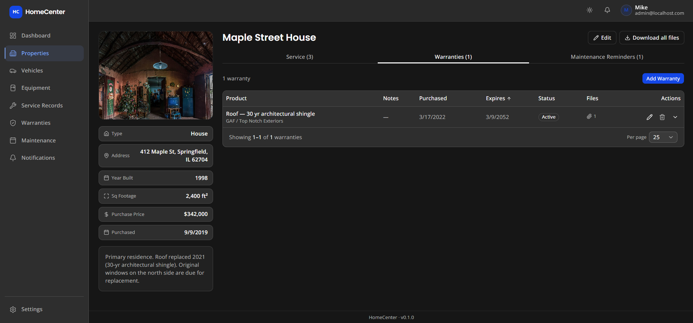</a>
<a href="docs/screenshots/10.WarrantyOverview.png">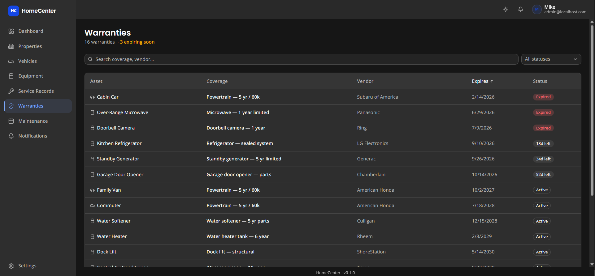</a>
<a href="docs/screenshots/4.ServiceRecord.png">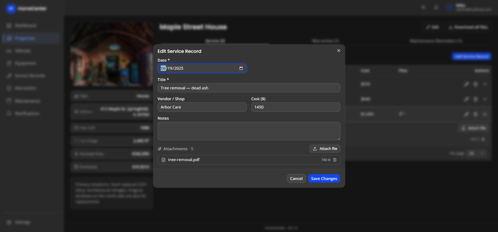</a>
</p>

### Your family's health records, close at hand *(optional)*

Keep each person's medical picture in one place, and print a clean summary for the next appointment.

- **Conditions, medications, allergies** and immunizations.
- **Visits** linked to providers, with costs.
- **Observation logs** to spot symptom patterns.
- **Refill, vaccine and insurance** reminders.
- If you don't need it, turn the whole section off in **Settings → Features**.

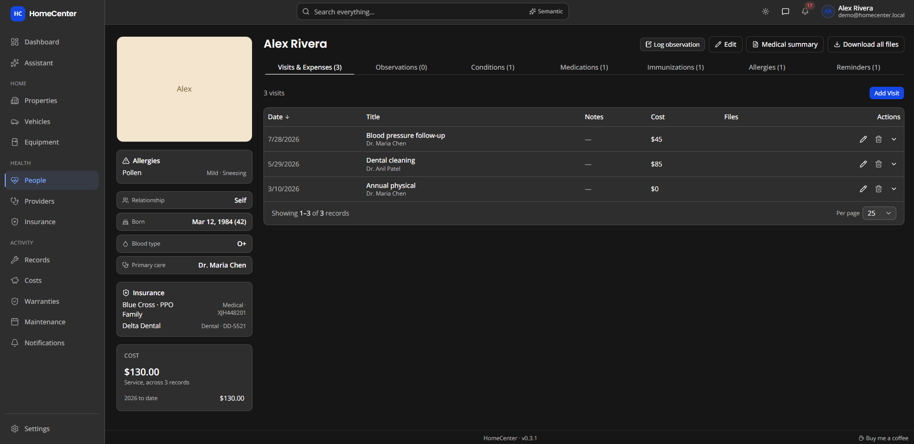

<p>
<a href="docs/screenshots/14.Providers.png">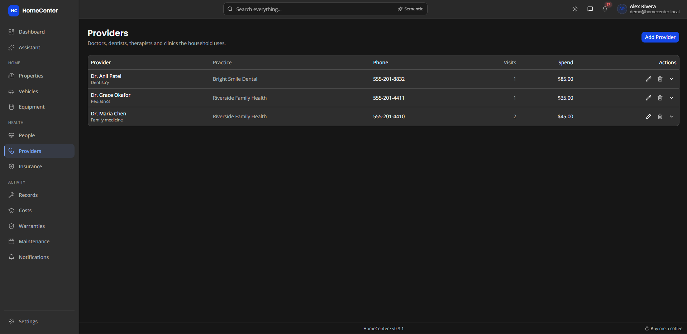</a>
<a href="docs/screenshots/15.Insurance.png">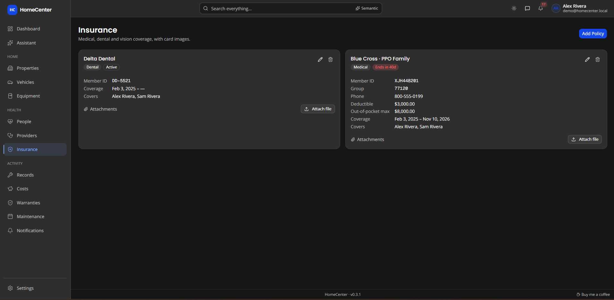</a>
<a href="docs/screenshots/16.MedicalSummary.png">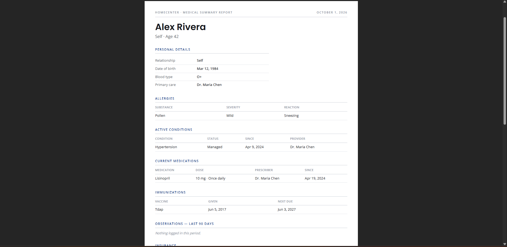</a>
</p>

### See where the money goes

Every service record carries a cost. HomeCenter adds them up across the whole household.

- **Monthly, quarterly or yearly** trends with a rolling average.
- Top assets, categories and vendors.
- **Biggest expenses** and year-to-date totals.
- Filter to properties, vehicles, equipment or people.

<p>
<a href="docs/screenshots/17.Costs1.png">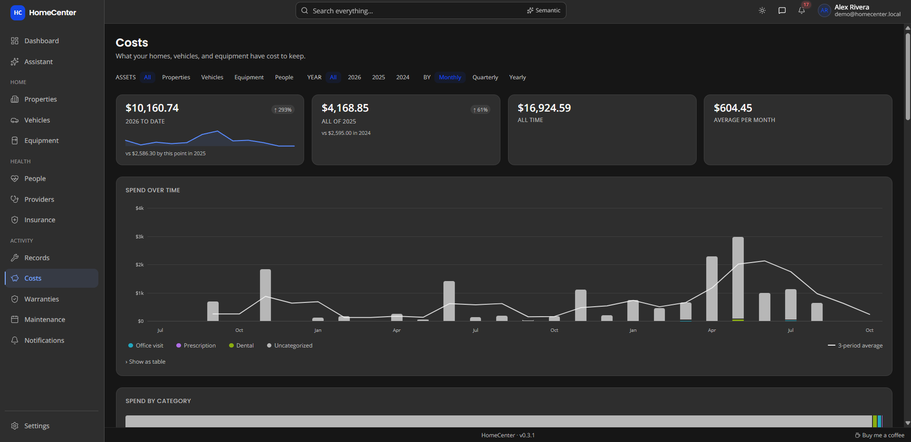</a>
<a href="docs/screenshots/17.Costs2.png"></a>
</p>

### Find anything, even inside the manual

One search box covers assets, records and the text of every file you've uploaded. Ask in your own words and it finds what you meant.

- **Reads** PDF, Word, Excel, PowerPoint, OpenDocument, RTF and text files.
- **OCR** for photos and scanned PDFs.
- **Search by meaning**, using a small model that runs on your server.
- Indexing and OCR run in the background, on your server.

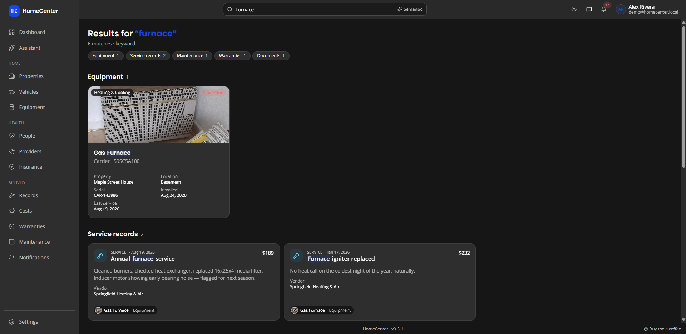

### Ask your house a question

The assistant *(optional)* looks up your records and documents to answer plain-language questions, with links back to the source.

- Works with OpenAI, OpenRouter, Ollama, LM Studio or any OpenAI-compatible server.
- **Run it fully local** and nothing leaves your network.
- You choose whether it may read documents and health data.
- Chats stay in your browser and are never stored on the server.


### Reminders and reports

Reminders arrive in the app and, if you like, by email. Reports turn an asset's history into a document you can hand to a buyer, a mechanic or a doctor.

- **Email digests** for each person: as soon as possible, daily or weekly.
- **Mail server set up in Settings**, with a test button.
- **Dismiss and restore** notifications.
- **Printable asset reports** and medical summaries.

<p>
<a href="docs/screenshots/18.Notifications.png">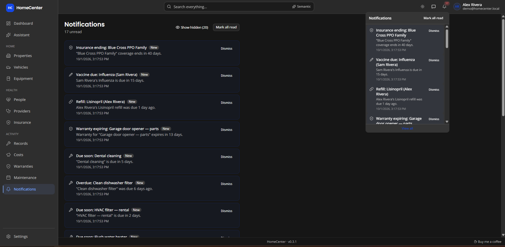</a>
<a href="docs/screenshots/12.EmailNotifications.png"></a>
<a href="docs/screenshots/19.AssetReport.png"></a>
</p>

## Private by design

HomeCenter is one container and one data folder, and you own both.

- **Self-hosted:** runs on a Synology, Unraid or any Docker host. Updates never touch your data folder.
- **On-device processing:** OCR and meaning search run inside the container. Their only network call is an optional model download.
- **You decide:** the AI assistant stays off until you turn it on, and Health can be hidden entirely. Login is local, users are admin or standard, repeated failed sign-ins are slowed down, and the mail password and API key are encrypted at rest.

<sub>Photos in the screenshots are from <a href="https://commons.wikimedia.org/">Wikimedia Commons</a>, by various authors, under their individual licenses (mostly CC BY-SA).</sub>

## Get started

Setup takes about five minutes. You need:

| Requirement | Why |
|---|---|
| Docker + Docker Compose | How the app runs. No Node.js or build setup needed. |
| A folder on the host for data | Holds the database and uploaded files, and survives updates |
| ~5 minutes | To set one required value and start the container |

### Install (Docker)

This is the recommended way to run HomeCenter.

**1. Create a folder for its data**, e.g. on a Synology NAS:

```bash
mkdir -p /volume1/docker/homecenter
```

**2. Save this as `docker-compose.yml`** (or paste it into Portainer → Stacks → Add stack):

```yaml
services:
  homecenter:
    image: ghcr.io/yatzin/homecenter:latest
    ports:
      - "3000:3000"
    volumes:
      - /volume1/docker/homecenter:/data
    environment:
      DATABASE_URL: "file:/data/homecenter.db"
      AUTH_SECRET: ""
      AUTH_URL: ""
      MAX_UPLOAD_BYTES: "26214400"
      ADMIN_NAME: "Admin"
      ADMIN_EMAIL: "your@email.com"
      ADMIN_PASSWORD: "changeme"
    restart: unless-stopped
    healthcheck:
      test: ["CMD", "wget", "-qO-", "http://127.0.0.1:3000/api/health"]
      interval: 30s
      timeout: 10s
      retries: 3
      start_period: 10s
```

Update the volume path to the folder you created in step 1.

**3. Set these values:**

| Variable | Required? | What to put |
|---|---|---|
| `AUTH_SECRET` | **Yes** | A random secret: `openssl rand -base64 32`. Without it, logins won't work. |
| `AUTH_URL` | No | The address you'll browse to, e.g. `http://192.168.1.50:3000`. Leave blank to auto-detect it. |
| `ADMIN_EMAIL` / `ADMIN_PASSWORD` | No | Your login, used once on first boot to create the admin account and ignored after that. If you remove `ADMIN_PASSWORD`, the password is `changeme` and you must change it on first login. Without `ADMIN_EMAIL`, the email is `admin@localhost`. |
| `NOTIFY_INTERVAL_MINUTES` | No | How often to check for due maintenance and expiring warranties. Defaults to `360` (6 hours). Set `0` to turn reminders off. An admin can override it under Settings → Notifications (minimum 5), no restart needed. |
| `SMTP_HOST` | No | Your mail server, e.g. `smtp.gmail.com`. **Leave blank and no email is ever sent.** The in-app bell still works. |

Everything else can stay at its default. Uploads (`/data/uploads`) and downloaded models (`/data/models`) are kept in the data folder automatically.

**4. Start it:**

```bash
docker compose up -d
```

(Portainer: click **Deploy the stack**.)

The container sets up its database and admin account automatically on first boot.

**5. Log in** at `http://<your-server-ip>:3000/login` with the admin email/password from step 3.

> **Keep it off the open internet.** HomeCenter holds your household's records, and optionally your family's health records, behind a single login. It serves plain HTTP on port 3000 and has no built-in HTTPS. Don't forward that port from your router or publish it to the web. For access away from home, use a VPN to your home network (WireGuard, Tailscale or your router's own). If you must publish it, put it behind a reverse proxy that adds HTTPS, set `AUTH_URL` to the public address, and use a long admin password.

## Customized dashboards

Arrange the dashboard your way: choose which cards it shows, how big each one is, and what each one covers. A card shows more as it grows: Properties goes from photos, to a list with addresses; Spending goes from a total, to a chart, to month-by-month bars, over this year or the last X months (you type the number); the Spending Breakdown keeps showing every category down to a single row or column, as a bar split by share or a compact ranking. Planned Spend (an add-on card) shows what the estimated costs on your reminders add up to over the next X months (you type the number, 1 to 24), the same figure as the Costs page: a number with the next item, then bars by month, then stacked by property, vehicle, equipment and people, then the biggest items. The asset cards (Properties, Vehicles, Equipment, People) can also be made long and thin, down to a single cell: one row tall shows a row of round photos (or initials), with names when there is room; one column wide shows a column of them; two columns wide shows a column of names. Each one opens that item, and a "+N" opens the full list. The dated lists (Records, Active Warranties, Due Maintenance, Reminders, Expiring Warranties) show real items at every size, with the total as a small badge: one row tall is a carousel that steps through the items by itself (pausing while you point at it or use the keyboard, and not at all if your device asks for reduced motion), with arrows, dots and swipe; two rows show the most pressing item and a couple more; taller cards list them, one line each on a narrow card and with asset and cost when there is room. Equipment Life (an add-on card) shows how old your equipment is against how long it should last: a count of what is past its life, then a status bar, then a bar per item with time left (or over), then the cost of replacing what is nearing the end; equipment needs an install or purchase date and an expected life to appear. Service Activity (an add-on card) is a calendar of the last X months (you type the number) with a square for each day service was recorded, darker the busier the day, for everything or for one property, vehicle or piece of equipment; point at or tap a day to see its records and cost. One row or one column wide, the calendar fills the whole card with its title over the top left corner (point at the title and it hops to the opposite corner); at larger sizes it adds month labels and totals. Health Visits & Expenses is the same for people's visits and expenses, and Health Observations for logged observations, each for everyone or one person, with each day shaded by its worst entry from mild to severe, as on the Observations tab. You can add the same card more than once, say one Reminders card for vehicles and another for the house. The layout is shared by everyone in the household. Phones get a layout of their own, so you can arrange the small screen separately.

- **Edit:** admins hover the wrench tab in the top-right corner of the page, touching the header (it slides out to read **Edit dashboard**) and click it. Drag a card to move it and drag its edges to resize it. Cards in the way slide down to make room and slide back if you drag on. Cards stay where you put them, so you can leave empty space between them (up to 5 empty rows; a card dropped further down stops 5 rows below the card above it). Every card also has a **Move & resize** button (and arrow keys on its handle) for moving without dragging. Use the gear for a card's settings (or double-click, or double-tap on a phone, the card itself; cards without settings ignore it), **×** to remove it (with Undo) and **Add card** to add one. Changes save as you go; click **Done** when you're finished. **Reset to default** brings back the standard layout on both desktop and phone.
- **On a phone:** tap the wrench tab in the top-right corner, then use a card's **Move & resize** menu to move it up or down and pick Small, Medium or Large. You can also press and hold its handle to drag it.
- **Text cards:** a **Text** card (under **Add card → Text & time**) shows a line or a few lines of your own: a heading, a note, a reminder for the household. Pick its style (Heading 1 to 4, Body, Small or Muted), its alignment, and whether it has a border; without one, the text sits straight on the page. The greeting at the top of the dashboard ("Welcome back, {user}") is a borderless Heading 1 Text card, so you can reword it, move it or remove it. The text is plain (you can't add formatting or links of your own); line breaks are kept, and text that doesn't fit ends in "…" with the full text in its tooltip. Text can include live values in braces, filled in each time the dashboard loads (the card's settings list them, and clicking one inserts it where the cursor is). Counts and lists follow the property filter, like the other cards:

  | Group | Value | Shows | Links to |
  | --- | --- | --- | --- |
  | You & time | `{user}` | Your first name. | — |
  | You & time | `{user_full}` | Your full name. | — |
  | You & time | `{date}` | Today's date, in your regional date format. | — |
  | You & time | `{weekday}` | Today's day of the week, like Tuesday. | — |
  | You & time | `{year}` | This year, like 2026. | — |
  | Attention | `{overdue}` | How many reminders are overdue. | Maintenance |
  | Attention | `{due_soon}` | How many more are due within 30 days (overdue ones not included). | Maintenance |
  | Attention | `{next_due}` | The most urgent reminder's name. | Maintenance (opens that reminder) |
  | Attention | `{next_due_date}` | The most urgent reminder's due date (empty when it is due by mileage). | Maintenance (opens that reminder) |
  | Attention | `{expiring_warranties}` | How many warranties end within 60 days. | Warranties |
  | Attention | `{next_expiring}` | The name of the warranty that ends soonest, within 60 days. | Warranties (opens that warranty) |
  | Attention | `{next_expiring_date}` | The date that warranty ends. | Warranties (opens that warranty) |
  | Attention | `{intake}` | How many items are waiting in Intake. | Intake |
  | Money | `{spend_ytd}` | Spending so far this year. | Costs |
  | Money | `{spend_month}` | Spending so far this month. | Costs |
  | Counts | `{properties}` | How many properties. | Properties |
  | Counts | `{vehicles}` | How many vehicles. | Vehicles |
  | Counts | `{equipment}` | How many pieces of equipment. | Equipment |
  | Counts | `{records}` | How many service records. | Records |
  | Counts | `{people}` | How many people. (needs Health on) | People |

  A value that has nothing to show (no next reminder, or `{people}` with Health off) is left out, along with the ", " or space just before it: "Welcome back, {user}" reads "Welcome back" for an account with no name. Names are exact (`{User}` is not `{user}`); anything in braces that isn't a value, like `{usr}`, shows as typed, and the settings warn about it. Double braces (`{{user}}`) and braces with spaces (`{ user }`) are always shown as typed.

  Values about a page or an item are links (the **Links to** column): click "14" in "{equipment} items" to open Equipment, or the next reminder's name to open the property, vehicle, piece of equipment or person it's for. They look like the rest of the text with a faint underline that darkens on hover, and a tooltip names where they go. A value that is left out is not a link, and links don't work while you're editing the dashboard.
- **Clock card:** the **Clock** (top right on the standard layout; **Add card → Text & time** to add one) shows the time and today's date. It shows your device's time, in the 12- or 24-hour format and the date format chosen in **Settings → Regional** (the card has no format setting of its own). Its settings: show seconds, show the date, and the clock face (automatic, whenever it fits, or never). One cell wide it shows just the time; two wide, the time over the date; two rows tall or more, an analog clock face with the time.

## Optional extras

HomeCenter works fully without these. Add them when you want them.

### Email notifications (optional)

Until a mail server is set up, reminders only appear in the app. There are two
ways to configure one.

**In the app** (easiest): sign in as an admin and go to **Settings → Mail
server**. Fill in the server, port, and login, save, then use **Send test
email** to confirm it works. No restart needed, and the password is stored
encrypted with your `AUTH_SECRET`.

**Or by environment variable**, if you'd rather bake it into the container:

| Variable | Default | What it does |
|---|---|---|
| `SMTP_HOST` | — | Mail server hostname. Nothing sends until this is set. |
| `SMTP_PORT` | `587` | `465` for implicit TLS, `587` for STARTTLS. |
| `SMTP_USER` / `SMTP_PASS` | — | Login for the mail server. With Gmail or iCloud, use an **app password**, not your account password. Omit both for an unauthenticated LAN relay. |
| `SMTP_SECURE` | auto | `true` forces TLS. Defaults to on for port 465, off otherwise. |
| `MAIL_FROM` | `HomeCenter <no-reply@homecenter.local>` | The From address. Many providers require this to match the authenticated account. |
| `DIGEST_HOUR` | `8` | Hour of day (0–23) for daily and weekly digests. |
| `MAIL_DRY_RUN` | — | `1` logs each message instead of sending it, so you can check the setup safely. |

**Anything set in Settings wins over the environment variable**, and clearing a
field in Settings falls back to it. The form labels which values came from the
environment, so it's clear what's in effect.

Because the stored password is encrypted with `AUTH_SECRET`, **changing
`AUTH_SECRET` makes it unreadable**. The app detects this, stops sending rather
than failing silently, and Settings prompts you to enter the password again.

Each user picks their own cadence under **Settings → Notifications**: off,
as soon as possible, daily, or weekly. New accounts default to daily.

Two caveats:

- Delivery is driven by the same timer as the reminder check, so a digest goes
  out on the first pass **at or after** `DIGEST_HOUR`, not exactly at it. With
  the default 6-hour interval it can be up to 6 hours late. Lower
  `NOTIFY_INTERVAL_MINUTES` if you want tighter timing.
- "As soon as possible" likewise means the next pass, not instantly.

**Who and how often.** An admin picks which accounts get notifications under
**Settings → Notifications → Who gets notifications** (everyone, by default).
Each person then chooses how often the same due item is raised again:

| Option | What you get |
|---|---|
| When it's coming up, and on the due date *(default)* | One heads-up, then one on the day |
| Only once | A single reminder |
| Every check until dismissed | Comes back after you read it, until you dismiss it |

A new due date always starts afresh, for example after you log the service or
move a refill date. Emails cover only new or re-raised reminders, so lowering
the interval doesn't mean repeat messages, except with "every check until
dismissed".

### AI assistant (optional)

Sign in as an admin and go to **Settings → Assistant**. Pick a provider (OpenAI,
Ollama, LM Studio, OpenRouter or any OpenAI-compatible server), enter the model
name and, if the provider needs one, an API key (stored encrypted). Use **Test
connection** to confirm the model supports tool calling, which the assistant needs.

Questions, and the records needed to answer them, are sent to that server,
including health records. Point it at a local model if that matters to you. When
HomeCenter runs in Docker, `localhost` means the container: use the host's
address (e.g. `http://host.docker.internal:11434/v1`) for a model running on the
host.

For Ollama, raise the context length. The default is too short for the tool
definitions and results, so answers get cut off or ignore the data. Set
`OLLAMA_CONTEXT_LENGTH=16384` (or more) on the Ollama server. Models of 7B
parameters or larger are recommended; small models often call the tools wrongly
or not at all.

For slow local models, **Time limit per question** (default 180 seconds) caps the
whole answer, including waiting for the model to load or read the prompt.
Raise it if answers time out. Once a reply starts streaming, it also stops if
the server then sends nothing for 60 seconds. **Extra request JSON** passes
server-specific options with every request, e.g.
`{"chat_template_kwargs": {"enable_thinking": true}}` to turn on a model's
thinking in llama.cpp or vLLM, or `{"reasoning_effort": "low"}` for OpenAI
reasoning models.

Chats stay in your browser tab and are never stored on the server.

### Document search (optional)

HomeCenter reads the text of uploaded files in the background (PDF, Word
(.doc/.docx), OpenDocument, PowerPoint, Excel, RTF, text/CSV, and photos or
scanned PDFs via OCR) and indexes it so the assistant can search it. It runs
entirely inside the container; nothing is sent anywhere until the assistant
uses a passage to answer a question.

**Settings → Documents & search** turns indexing and OCR on or off and shows progress.
**Settings → Assistant** decides whether the assistant may read documents at
all, and separately whether it may read health documents (files on anything
that belongs to a person, such as their visits, reminders and medications). That one is off
by default.

| Variable | Default | Meaning |
|---|---|---|
| `SEARCH_INDEX_PATH` | next to the database (`/data/search-index.db`) | The keyword index. Derived data: it doesn't need backing up and is rebuilt automatically if missing. |
| `DOCUMENT_REINDEX_HOURS` | `6` | How often to pick up missed or failed files. `0` disables the timer (uploads are still indexed immediately). |

Not indexed: iWork files, .zip, legacy .xls/.ppt and HEIC photos.

#### Search by meaning

Besides exact words, HomeCenter can find passages by meaning ("how often do I
swap the furnace filter?" finds "replace every 90 days"). A small AI model runs
**on your server**, so no document text leaves it for this. The model loads only
while documents are being indexed or searched, and unloads when idle.

**Settings → Documents & search → Find documents by meaning** turns it on or off and
picks the model:

| Model | Size | Good for |
|---|---|---|
| BGE small (built in) | 34 MB | Fast, English |
| Arctic Embed M | 110 MB | Best quality for its size, English (recommended upgrade) |
| BGE base | 110 MB | Better quality, English |
| Nomic Embed Text | 137 MB | Good quality, English |
| E5 base | 279 MB | Many languages |
| BGE large | 337 MB | Highest quality, slow on small hosts |

Larger models download from Hugging Face when you click **Download** (the
only time HomeCenter goes online for this) and are stored in `/data/models`.
Switching models re-processes your documents in the background.

| Variable | Default | Meaning |
|---|---|---|
| `MODELS_DIR` | `/data/models` | Where downloaded models are kept. |
| `EMBEDDING_IDLE_MINUTES` | `10` | Unload the model this long after the last search. `0` unloads right after each search. |

## FAQ

### Does it need an internet connection?

No. HomeCenter runs on your local network. It goes online only for things you turn on: email reminders, a cloud AI provider, or downloading a larger search model.

### What does the AI assistant send, and where?

Your question and the records needed to answer it go to the AI provider you configure, including health records if you allow it. Point it at Ollama or LM Studio on your own network and nothing leaves. The assistant is off until an admin sets it up, and chats are never stored on the server.

### How do I back it up?

Settings → Data. **Back up now** makes a verified backup; a daily or weekly **schedule** keeps the newest 14 (configurable). Point the folder at a different disk or NAS share (mount it in `docker-compose.yml`, e.g. `/backups`), because a backup on the same disk as your data doesn't survive that disk failing.

Each backup is one file holding the database and every uploaded file. Protection is optional: none, a **recovery key** (the server can't open its own backups), or a **password zip** (opens in 7-Zip, WinRAR or Keka). From the command line: `npm run backup` and `npm run backup:verify -- <file>`.

Keep your `AUTH_SECRET`: an unprotected backup restored under a different one asks you to re-enter the mail password, AI key and push URL. Protected backups carry them.

**Restoring** is done in the app (Settings → Data), or from the command line when the app won't start: stop HomeCenter, then `npm run restore -- <file>` (`--dry-run` to only look). The command line swaps the data in right away. The next start upgrades the database if the backup is older and finishes the restore (everyone is signed out, carried secrets are put back); in Docker that start is the container restarting. `npm start` outside Docker does not run `prisma migrate deploy`, so run `npx prisma migrate deploy` before starting if the backup came from an older version. A restore made in the app waits for a restart; `npm run restore -- --cancel` (or **Cancel staged restore** in Settings → Data) takes it back. In Docker, `docker compose run --rm --no-deps --user nextjs --entrypoint npm homecenter run restore -- /data/backups/<file> --yes` runs it in a fresh container.

### Can I reach it from outside my home?

Not safely by opening a port. HomeCenter has no built-in HTTPS and its login is the only protection, so don't expose port 3000 to the internet. Use a VPN into your home network instead, or put the app behind a reverse proxy that adds HTTPS and set `AUTH_URL` to the public address.

### Will it run on my NAS?

Images are built for amd64 and arm64, so it runs on Synology, Unraid and other Docker hosts, including 64-bit ARM boards such as a Raspberry Pi.

### Can everyone in the house have their own login?

Yes. An admin adds users under Settings → Users as admin or standard. Everyone sees the same household records. Admins also manage users, features, mail and the assistant, and each person chooses their own email reminders.

### How is health data protected?

It stays in the database on your server, behind HomeCenter's login with sign-in throttling. The database file itself isn't encrypted, so protect the data folder like any other private files. The assistant can't read health documents unless an admin allows it, and you can hide the Health section entirely.

## Updating

Pull the new image and recreate the container. Your data folder is untouched:

```bash
docker compose pull && docker compose up -d
```

In Portainer: **Pull and redeploy**.

From this version the image is based on Debian slim instead of Alpine. Nothing changes for you: pull and recreate as usual.

## Local development

For working on the app itself, not for regular use.

```bash
npm install
cp .env.example .env   # fill in AUTH_SECRET
npm run db:seed
npm run dev
```

Runs at [http://localhost:3000](http://localhost:3000), database at `prisma/dev.db`.

```bash
npm run db:migrate   # create/apply a migration
npm run db:studio    # browse the database
npm run build         # production build
```

**Adding a dashboard card type:** add its definition (sizes, tiers, settings) to `CARD_TYPES` in `lib/dashboard/card-types.ts`, a loader that fetches its data in `lib/dashboard/loaders.ts` (`LOADERS`), and a view in `components/dashboard/cards/` registered in `components/dashboard/cards/index.ts`. Unit tests for the pure layout logic live beside it in `lib/dashboard/*.test.ts`.

**Text card values:** the tokens live in one table, `TEXT_TOKENS` in `lib/dashboard/text-template.ts` (name, group, help line, the data it needs); the settings dialog's help list and the table above are both made from it (a test checks this README against it). The `text` loader parses the card's text, works out which kinds of data its known tokens need (`textNeeds`), and runs one count query per kind, in parallel and only for those (plain text, `{user}` and the date run none). The Attention values share the Due Maintenance card's list (`dueMaintenance`), the money values the Spending cards' rows and helpers (`spendingSummary`, `spendThisMonth`), and `{intake}` the Intake card's list; all follow the device's property filter and the Health setting. A query that fails leaves its values empty (and is logged) rather than failing the card. The card receives the finished text as segments, plain or link (`renderSegments`; `renderText` is the same as one string, for the tooltip and the settings preview), so the browser fetches nothing more. A token's link comes only from `TEXT_TOKENS` (`href`, the page the neighbouring card's "view all" opens) or, for `{next_due}`, `{next_due_date}`, `{next_expiring}` and `{next_expiring_date}`, from the loader (`dueTokenLinks`, `expiringTokenLinks`: the item's page with `?tab=…&open=<id>`, built by `lib/deep-link.ts`, which opens that reminder's or warranty's edit dialog; the lists drop `open` from the address once it has opened the dialog); the text has no link syntax, so a user can't make a link, and the view keeps a link only for a path on this site.

`npm run models:fetch-builtin` downloads the built-in model into `./models/builtin/` (needed once for meaning search in development).

Images are built and published automatically by `.github/workflows/docker-publish.yml` on every push to `main`. To build locally: `docker build -t home-center .`

---
## License

HomeCenter is source-available software licensed under the [PolyForm Noncommercial License 1.0.0](https://polyformproject.org/licenses/noncommercial/1.0.0/).

You may use, modify, and redistribute HomeCenter for permitted noncommercial purposes, subject to the license terms. Commercial use requires separate permission from the copyright holder.

HomeCenter is not open source under the standard Open Source Definition because the license restricts commercial use.
